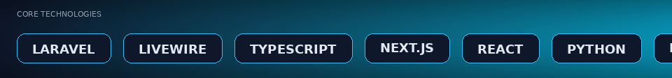

<!--
  Profile README for github.com/rivanalamsyah
  Repository name must match the GitHub username: rivanalamsyah
-->

<h1 align="center">
  Hello, I'm Rivan Alamsyah
</h1>

<h3 align="center">
  Full-Stack Web Developer | Business Systems | Cloud & AI Integration
</h3>

  Building scalable web applications and business solutions through modern software engineering.

  

  
  
  

---

## About

I'm a **Full-Stack Web Developer** with **2+ years of experience** designing, developing, and maintaining web applications and business-critical systems. My work includes **Enterprise Resource Planning (ERP), Human Resource Management Systems (HRMS), Customer Relationship Management (CRM), and Translation Management Systems (TMS)**.

I work across frontend, backend, and data layers, with a focus on building secure, maintainable applications that support real business workflows. I enjoy turning complex requirements into practical software through thoughtful architecture, clean implementation, and collaboration.

- **Based in:** Jakarta, Indonesia
- **Education:** B.Sc. in Information Systems, Universitas Ahmad Dahlan
- **GPA:** 3.48 / 4.00
- **Primary stack:** Laravel, Livewire, TypeScript, Next.js, React, Firebase
- **Currently interested in:** System design, cloud architecture, AI/ML integration, and workflow automation

---

## Featured Projects

The projects below are selected from my professional CV. The descriptions reflect my stated contributions and project scope.

<table>
  <tr>
    <td width="50%" valign="top">
      <h3>01 · MyASN / ASN Digital</h3>
      
<strong>Mobile Application Development</strong>

      
Contributed to the development of BKN's MyASN / ASN Digital mobile application, integrating digital personnel services for Indonesian civil servants.

      <ul>
        <li>React Native mobile application development.</li>
        <li>Integration of backend services through REST APIs.</li>
        <li>Features include Individual ASN Dashboard, E-Kinerja, SIASN, Digital Competency Development, and Disability Services.</li>
        <li>API testing and database tooling with Postman and DBeaver.</li>
      </ul>
      

        
        
        
      

    </td>
    <td width="50%" valign="top">
      <h3>02 · Enterprise Resource Planning</h3>
      
<strong>ERP · Inventory · Sales · HR</strong>

      
Built a full-stack ERP system that brings core business operations together through modular services and REST APIs.

      <ul>
        <li>Integrated inventory, sales, and HR workflows.</li>
        <li>JWT authentication for protected API access.</li>
        <li>Celery and Redis for background processing.</li>
        <li>PDF report generation with WeasyPrint.</li>
      </ul>
      

        
        
        
        
      

    </td>
  </tr>
  <tr>
    <td colspan="2" valign="top">
      <h3>03 · CRM for Language Services</h3>
      
<strong>Translation · Legalization · Interpreter Services</strong>

      
Built a CRM platform for translation, document legalization, and interpreter service businesses to manage client relationships and streamline service workflows.

      <ul>
        <li>Client lifecycle and service workflow management.</li>
        <li>Real-time data synchronization with Cloud Firestore.</li>
        <li>Secure authentication and access management.</li>
        <li>Cloud document storage integration.</li>
      </ul>
      

        
        
        
        
      

    </td>
  </tr>
</table>

---

## More Projects

Additional projects and prototypes from my development portfolio. The technology stacks below are based on my existing project descriptions.

  
<strong>AI & Data Engineering</strong>

  | Project | Overview | Tech stack |
  |---|---|---|
  | Student Graduation Predictor | SVM-based application to estimate student graduation probability with data visualization. | Flask, Scikit-learn, Pandas, NumPy |
  | AI-Powered Resume Analyzer | NLP-based resume analysis with improvement suggestions and job matching. | FastAPI, spaCy, Transformers, React, Firebase |
  | Instagram Analytics DSS | Engagement and performance analytics for digital marketing decisions. | Streamlit, Python, SQLite, Plotly, TextBlob, VADER, Scikit-learn |
  | Multimethod Employee Selection System | Employee selection decision support using MFEP, Fuzzy Logic Mamdani, and SAW. | Flask, SciPy, Scikit-Fuzzy, Pandas, MySQL |

  
<strong>Backend & Full-Stack Systems</strong>

  | Project | Overview | Tech stack |
  |---|---|---|
  | Warehouse Management System | Inventory tracking, barcode scanning, and multi-warehouse support. | React, Node.js, PostgreSQL, Redis, Docker |
  | HR Management System | Role-based HR platform for attendance, payroll, and performance management. | Flask, MySQL, REST API, Chart.js, JWT |
  | Hotel Booking CMS Dashboard | Booking management, room inventory, and financial reporting. | Laravel, Livewire, MySQL, Tailwind CSS, Alpine.js, Chart.js |
  | Vendor Management System | Vendor lifecycle, contract administration, and financial operations. | Laravel 12, Livewire, MySQL, Redis, Tailwind CSS |

  
<strong>Frontend & Web Applications</strong>

  | Project | Overview | Tech stack |
  |---|---|---|
  | Construction Company Profile | Corporate website concept for construction businesses and project tenders. | Next.js 15, TypeScript, Tailwind CSS 4, shadcn/ui |
  | Gym & Fitness Landing Page | Fitness landing page with glassmorphism and motion effects. | Next.js 15, TypeScript, Tailwind CSS, Framer Motion |
  | Premium Kos with AI Chat | Boarding house website with AI chatbot and virtual-tour experience. | Next.js 15, TypeScript, Tailwind CSS, shadcn/ui, AI SDK |
  | Sportswear E-commerce | Online store with cart, checkout, and responsive interface. | React, Redux, Node.js, MongoDB, Stripe |
  | Coffee Shop Website | Website concept with menu, online ordering, and reservations. | Next.js 15, TypeScript, Tailwind CSS 4, Prisma, shadcn/ui |

  
<strong>Management & Administration Systems</strong>

  | Project | Overview | Tech stack |
  |---|---|---|
  | Mosque Management System | Congregation administration and financial tracking. | Laravel 12, MySQL, Tailwind CSS, Alpine.js, Chart.js |
  | School Management CMS | Student records, academic administration, and financial management. | Laravel, Livewire, MySQL, Tailwind CSS, Alpine.js |
  | RT/RW Administration System | Population information and neighborhood administration. | Laravel 12, Livewire 3, MySQL, Tailwind CSS |
  | Catet Academy | E-learning platform with video, quizzes, and payment integration. | Laravel, Livewire, MySQL, Midtrans |
  | MyNotes | Personal notes and task organization application. | Laravel 12, MySQL, Tailwind CSS, Alpine.js |

  
<strong>Automation & Workflow Engineering</strong>

  | Project | Overview | Tech stack |
  |---|---|---|
  | Reddit AI Digest | Monitors Reddit content and uses AI for classification and summaries. | n8n, OpenAI API, RSS, JavaScript |
  | AI Email Reply & Google Sheets | AI-assisted email replies with feedback tracking. | n8n, Gmail API, OpenAI, Google Sheets API |
  | YouTube to Discord | Summarizes YouTube videos and publishes summaries to Discord. | n8n, YouTube API, Discord Webhook |
  | Social Media Upload Automation | Automates video publishing with AI-generated descriptions. | n8n, Google Drive API, OpenAI, upload-post.com |
  | WhatsApp Business Integration | Business messaging automation through webhooks. | n8n, WhatsApp Business API, Webhooks |

---

## Tech Stack

  

  <strong>Frontend</strong> 
  

  <strong>Backend</strong> 
  

  <strong>Database & Cloud</strong> 
  

  <strong>Tools & DevOps</strong> 
  

  <strong>AI & Data</strong> 
  
  
  
  
  

---

## Engineering Focus

| Domain | Focus |
|---|---|
| Full-Stack Development | End-to-end feature delivery across frontend, backend, and database layers |
| Backend Engineering | REST API design, business logic, authentication, and authorization |
| System Design | Modular architecture, maintainability, and scalable application structure |
| Data Engineering | Relational and NoSQL data modeling, integration, and processing |
| Enterprise Applications | ERP, HRMS, CRM, TMS, and operational workflow systems |
| AI Integration | NLP, predictive modeling, and AI-enabled application features |
| Cloud & DevOps | Firebase services, Docker, deployment, and CI/CD fundamentals |
| Automation | API integrations and workflow automation with n8n |

---

## Professional Experience

**Full-Stack Developer · CV Master Penerjemah Indonesia**  
_January 2026 – December 2026_

- Develop and maintain a Translation Management System (TMS) and document tracking platform using TypeScript, Laravel, and Livewire.
- Build workflows for translation operations, task assignments, operational management, and document tracking.
- Develop and maintain WordPress company websites, with attention to responsive UI/UX, database integration, SEO, and performance.

**Full-Stack Developer · PT Catet Consulting Indonesia**  
_September 2024 – September 2025_

- Developed full-stack application features using Laravel and Livewire.
- Implemented frontend interfaces, backend business logic, RESTful APIs, and relational database integration.
- Collaborated on requirements analysis, troubleshooting, testing, and Git-based development workflows.

**Front-End Developer · PT Linkdataku Solusi Indonesia**  
_February 2024 – July 2024_

- Developed responsive, mobile-first interfaces using Tailwind CSS and Alpine.js in Laravel applications.
- Translated UI/UX designs into functional and reusable components.
- Conducted cross-device and cross-browser testing to improve usability and visual consistency.

---

## GitHub Analytics

  
  

  

### Contribution Activity

  <picture>
    <source media="(prefers-color-scheme: dark)" srcset="https://raw.githubusercontent.com/rivanalamsyah/rivanalamsyah/output/github-contribution-grid-snake-dark.svg" />
    <source media="(prefers-color-scheme: light)" srcset="https://raw.githubusercontent.com/rivanalamsyah/rivanalamsyah/output/github-contribution-grid-snake.svg" />
    
  </picture>

---

## Let's Connect

  
  
  
  

  

  

  Building reliable software. Improving business workflows. Learning continuously.

